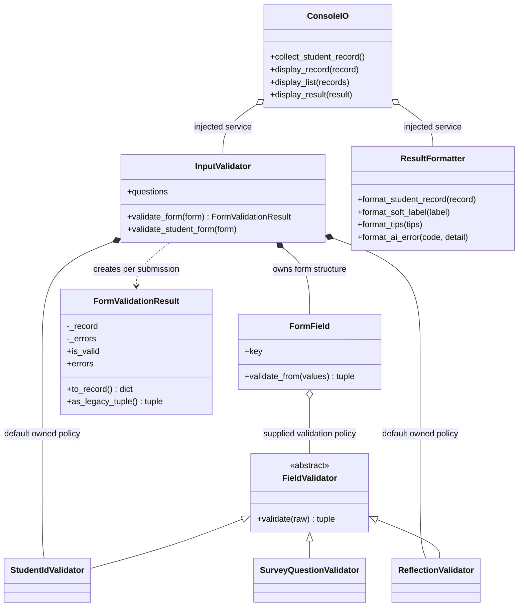

# I/O manager: Phase 2 design notes

The I/O responsibility remains in `io_manager.py`: collect and validate input,
format records and results, and display console output. AI calls, scoring and
persistence remain in their respective managers. The Flask entry point now
creates `InputValidator` and `ResultFormatter` objects and calls their methods.
The input manager owns a stable collection of `FormField` objects. Each submission
produces a `FormValidationResult` that owns either a valid record or field errors.
Both the web route and console use this result object before handing a record
to the rest of the application.

## Your I/O responsibility

`FormField` models a named input and collaborates with a validation policy.
`InputValidator` constructs and owns the form fields and snapshots the question
definitions. Fields and policies are reused; student answers stay local to each
call. `FormValidationResult` owns the outcome of a single submission and prevents
an invalid result from being exported as a record. It returns defensive copies
and excludes raw reflection. These are meaningful data-owning objects, rather
than additional containers for unrelated functions.

The public handoff for teammates is:

```python
from io_manager import InputValidator, ResultFormatter

inputs = InputValidator()
presentation = ResultFormatter()
validation = inputs.validate_form(form_values)
if validation.is_valid:
    record = validation.to_record()  # pass to the existing AI pipeline
else:
    errors = validation.errors      # show field-specific messages
```

`form_values` is the submitted mapping. This snippet demonstrates the handoff;
it does not process or save records. AI processing must still succeed before the
other managers finalize a result. The existing web route implements that flow.

## Classes and OOP evidence

| Concept | Implementation evidence |
| --- | --- |
| Classes and objects | Flask uses validator and formatter instances; the CLI uses `ConsoleIO`. |
| Encapsulation | Dependencies and configuration use `_` names; `questions` returns a deep copy; formatters snapshot their question definitions. No submission is retained on an object. |
| Abstract class / interface | `FieldValidator.validate(raw)` defines the common `(ok, value_or_error)` contract and cannot be instantiated directly. |
| Inheritance | `StudentIdValidator`, `ReflectionValidator`, and `SurveyQuestionValidator` implement that contract for distinct input types. |
| Polymorphism | `InputValidator.validate_form` iterates its fields; `FormField.validate_from` calls the same `validate` operation on all three policy implementations without concrete-type checks. |
| Association | `ConsoleIO` calls an injected `read`/`write` collaborator; these callables are not owned by the console. |
| Aggregation | A console can hold independently created validator/formatter services. An input validator can also accept an independently created field policy. |
| Composition | `InputValidator` constructs and owns its form fields and default policies; `ConsoleIO` creates its own services when none are supplied. |

Ownership depends on construction: a dependency supplied by the caller is shared;
a default created internally is owned. Python references do not enforce exclusive
ownership; these are explicit design conventions, not claims about deterministic
destruction. No artificial manager inheritance has been introduced.



The diagram shows injected console services. Default console construction uses
composition instead. The private `_InputText` utility centralizes normalization
and operator-detail redaction; it has no mutable state.

## SOLID justification

- **SRP:** Field policies validate one kind of input. `InputValidator` coordinates
  a submission; `ResultFormatter` prepares presentation dictionaries; `ConsoleIO`
  reads and prints. No I/O class scores or saves a record.
- **OCP:** An alternative ID or reflection policy can implement `FieldValidator`
  and be injected without editing the form-processing loop. Survey definitions
  can be supplied to validation and formatting. The visitor-policy test is an
  example of extension, not a change to production ID requirements.
- **LSP:** All field implementations accept raw input and return the same pair.
  Invalid user input returns an error message rather than an exception. The
  field can substitute implementations without concrete-type branching.
- **DIP:** Form coordination uses the field-validation contract; console I/O
  accepts services and callables so tests need neither a terminal nor live AI.

## Data flow and failure handling

`Web form / console -> InputValidator -> FormField / FieldValidator ->
FormValidationResult -> existing AI manager -> logic manager -> data manager ->
ResultFormatter -> web / console`.

Reflection is validated and passed to the existing local survey safety check;
only its boolean flag enters the record. Reflection text is not persisted or
sent to AI. This refactor preserves the existing AI-required processing path.

| Situation | Behavior |
| --- | --- |
| Invalid ID / missing or invalid answer | Return field-keyed errors; console retries invalid input. |
| Invalid reflection | Return an error without including submitted text. |
| Unknown label or tip | Preserve existing error payload / drop unknown tips. |
| AI timeout, unavailable or malformed response | Existing failure formatter supplies the established error payload. |
| Unknown AI error code | Normalize to `unavailable` with an error description. |
| Operator detail resembling a secret | Existing redaction policy suppresses it. |
| Console EOF / cancellation | Propagates to the caller; no partial record is saved. |
| Exporting an invalid validation result | Raises `ValueError`; the web route checks `is_valid` first. |

## Compatibility and testing

Legacy module names remain as bound-method aliases for existing Phase 1 tests
and integrations. There are no top-level function definitions in `io_manager.py`.
New application code should instantiate the classes directly. The small
`__main__` block only wires the console entry point.

Run from the repository root:

```text
python -m unittest discover -s tests -v
python -m unittest discover -s tests -p "test_io*.py" -v
```

`test_io_classes.py` covers the existing object API. `test_io_contracts.py` covers
ABC enforcement, substitutable field implementations, injected policy extension,
defensive configuration copies, injected formatting, accumulated errors and
console/form equivalence. Existing web tests exercise the direct object calls.
Tests run without a live AI API.

`test_io_form_objects.py` checks owned record/error copies, exclusion of reflection,
rejection of ambiguous outcomes, prevention of invalid record export, independent
field policies, stable schema snapshots, tuple compatibility and submission
isolation. Existing frontend tests check that malformed submissions still produce
HTTP 400 and successful submissions still use the AI pipeline.

## Scope and remaining team requirements

This is an I/O refactor, not a claim that the whole Phase 2 submission is complete.
Other managers, `survey.py` and Flask route orchestration still contain procedural
functions. The team must finish that migration and decide whether to remove the
transitional aliases before submission. This refactor is not the required new
meaningful feature. The team must also demonstrate that feature, an advanced
feature, the complete system UML/data flow/exception matrix, a report of at most
six pages, TeamAId evidence, meaningful Git history, and successful Docker/CI runs.
The existing web UI may support the GUI advanced deliverable, but this change
does not establish its assessment eligibility or completion.
